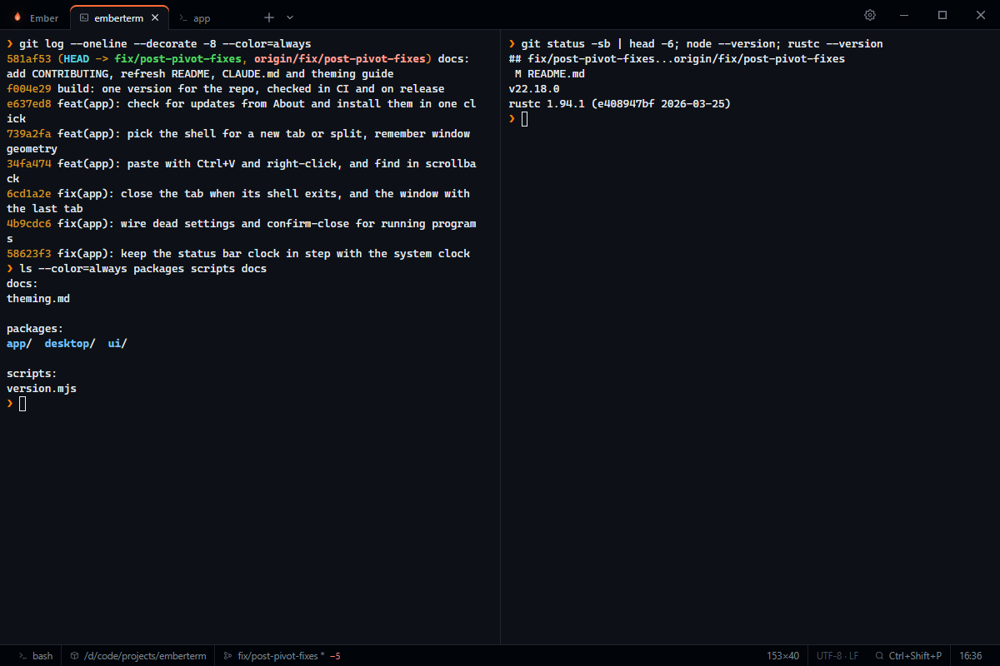

<h1 align="center">EmberTerm</h1>

<p align="center"><b>A fast, simple terminal for Windows.</b></p>

<p align="center">
  <a href="https://github.com/emberterm/emberterm/actions/workflows/ci.yml"></a>
  <a href="https://github.com/emberterm/emberterm/releases"></a>
  <a href="https://tauri.app"></a>
  <a href="LICENSE"></a>
</p>

EmberTerm is a lightweight terminal built on Tauri 2 (Rust), Svelte 5 and xterm.js with `portable-pty`.
Many tabs, each with its own shell (Git Bash, WSL, PowerShell, cmd), split panes, and your last
session back when you reopen it. No account, no telemetry.



## Features

- **Session restore:** closing and reopening brings back every tab, split, title and folder
- **Shells per tab:** pick Git Bash, WSL, PowerShell or cmd from the arrow beside `+`, or set a default profile
- **Splits:** side by side or stacked, any shell in each pane
- **Copy, paste, find:** Ctrl+C (with a selection) / Ctrl+Shift+C, Ctrl+V, a right-click menu, and Ctrl+Shift+F to search the scrollback
- **Tab status:** a dot marks a tab that is running a command or has new output; closing a tab with a program running asks first
- **Themes:** 7 built-in, or paste any VS Code theme JSON; the choice is remembered
- **Settings you would expect:** fixed-width font picker, font size, padding, cursor, scrollback, bell, keymap reference
- **Command palette:** Ctrl+Shift+P for tabs, profiles, splits and themes
- **Status bar:** shell, folder, git branch and changes, size, clock
- **Window memory:** size, position and maximized state come back
- **Updates:** Settings → About → Check for updates downloads and installs the latest release in one click
- **Robust files:** config, profiles and `session.json` hot-reload; a broken file is moved aside with a toast and never blocks startup

## Why EmberTerm

Terminals that forget your tabs, or fail to start after an update, cost you time every day.
EmberTerm keeps one job: open fast, show your shells, and bring everything back the way you left it.
Settings, profiles and the session are plain files you can read, and a broken file never blocks startup.

## Folder restore

EmberTerm restores each tab's folder for Git Bash, WSL and PowerShell by injecting a prompt hook.
If your `~/.bashrc` *assigns* `PROMPT_COMMAND=...` or `PS0=...`, the hook is replaced. Append instead:

    PROMPT_COMMAND="${PROMPT_COMMAND:+$PROMPT_COMMAND;}your_command"

The same hook tells EmberTerm when a command is running in Git Bash and WSL (needs bash 4.4+), which is
what makes "close this tab?" accurate there. cmd does not restore its folder.

## Install

Download the latest `-setup.exe` from the [Releases](https://github.com/emberterm/emberterm/releases)
page. Builds are not code-signed, so Windows SmartScreen may ask you to confirm. After that, updates
come from inside the app.

## Development

Prerequisites: [Rust](https://rustup.rs/) 1.85+, [Node.js](https://nodejs.org/) 22+,
[pnpm](https://pnpm.io/) 9+, and WebView2 (preinstalled on Windows 11).

```sh
git clone https://github.com/emberterm/emberterm
cd emberterm
pnpm install
pnpm dev                 # desktop app with hot reload
```

```sh
pnpm turbo build                                          # frontend
cargo build --manifest-path packages/desktop/Cargo.toml   # app
cargo test --manifest-path packages/desktop/Cargo.toml    # Rust tests
pnpm turbo check test                                     # type-check + frontend tests
```

Installers are written to `packages/desktop/target/release/bundle/`. See
[CONTRIBUTING.md](CONTRIBUTING.md) for code style, pull requests, versioning and releases.

## Project structure

```
packages/
  desktop/   Rust/Tauri core: PTY, shell hooks, config, profiles, session file, IPC
  app/       Svelte 5 UI: xterm.js, tabs, splits, settings, themes (@emberterm/app)
  ui/        Shared Svelte components (@emberterm/ui)
scripts/     version.mjs: one version for the whole repo
docs/        theming.md: writing and importing themes
```

[CLAUDE.md](CLAUDE.md) has the architecture, file map and IPC reference.

## Docs and contributing

[Contributing](CONTRIBUTING.md) · [Theming](docs/theming.md) · [Architecture](CLAUDE.md) · [Changelog](CHANGELOG.md) · [Security](SECURITY.md)

## License

[MIT](LICENSE). Windows is the primary target; macOS builds are also published.
